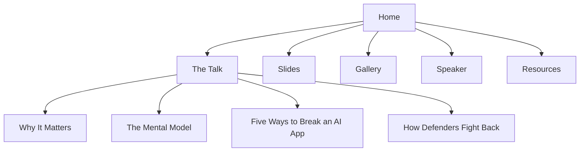

<div align="center">

# 🛡️ Hacking AI

### The Security Risks Behind AI

**Publication site for a guest talk on how AI-powered applications get broken, and how defenders fight back.**


*Guest talk delivered at the OWASP University of Exeter Student Chapter, opening the 2026/2027 academic year.*

**[🌐 View the live site](https://code-tech77.github.io/hacking-ai-owasp-exeter/)**


</div>

---

## Table of Contents

1. [Overview](#overview)
2. [Event Context](#event-context)
3. [About the Talk](#about-the-talk)
4. [Key Takeaways](#key-takeaways)
5. [Site Features](#site-features)
6. [Site Map](#site-map)
7. [Tech Stack](#tech-stack)
8. [Project Structure](#project-structure)
9. [Getting Started](#getting-started)
10. [Deploying to GitHub Pages](#deploying-to-github-pages)
11. [Editing and Customisation](#editing-and-customisation)
12. [Screenshots](#screenshots)
13. [Responsible Use](#responsible-use)
14. [Speaker](#speaker)
15. [Acknowledgements](#acknowledgements)
16. [License](#license)

---

## Overview

This repository holds the **publication website** for *Hacking AI: The Security Risks Behind AI*, a guest talk by **Mohammed Zuoriki** at the **OWASP University of Exeter Student Chapter**.

The site is the written companion to the session. It expands each part of the talk into a readable article, includes the full slide deck and photos from the evening, and links to resources for anyone who wants to keep learning about AI and LLM security.

It is built with **plain HTML, CSS and JavaScript**: no framework, no dependencies and no build step. GitHub Pages serves it as it is.

---

## Event Context

| | |
|---|---|
| **Event** | OWASP University of Exeter Student Chapter, opening of the cybersecurity programme |
| **Academic year** | 2026/2027 |
| **Venue** | University of Exeter |
| **Date** | October 2026 |
| **Role** | Guest Talk Speaker |
| **Talk** | *Hacking AI: The Security Risks Behind AI* |
| **Audience** | Students and local tech enthusiasts, no prior security background required |

---

## About the Talk

> *"When natural language becomes the execution engine, words turn into untrusted inputs."*

The talk looks past traditional code vulnerabilities to a newer class of problem: **conversational exploits that persuade AI systems to misbehave**. It is organised in four parts:

| Part | Topic | Summary |
|---|---|---|
| **01** | **Why it matters** | LLMs have moved from study helpers to production systems wired into databases, ticketing queues and payment portals. |
| **02** | **The mental model** | AI is a *very eager intern*: fast, well-read, eager to please, and with no situational awareness. |
| **03** | **Five ways to break an AI app** | Prompt injection, jailbreaks, data leaks, poisoned data and insecure actions, each mapped to the OWASP Top 10 for LLM Applications. |
| **04** | **How defenders fight back** | Least privilege, treating every input as untrusted, a human in the loop for risky actions, and testing like an attacker. |

### Threat landscape mapped to OWASP

| Threat family | OWASP Top 10 for LLM Applications |
|---|---|
| Prompt Injection | LLM01 Prompt Injection |
| Jailbreaks | LLM01 Prompt Injection |
| Data Leaks | LLM02 Sensitive Information Disclosure, LLM07 System Prompt Leakage |
| Poisoned Data | LLM03 Supply Chain, LLM04 Data and Model Poisoning, LLM08 Vector and Embedding Weaknesses |
| Insecure Actions | LLM05 Improper Output Handling, LLM06 Excessive Agency |

---

## Key Takeaways

1. **AI changes the attack surface, not the fundamentals.** Untrusted input, excessive privilege and missing oversight are old problems in a new form.
2. **Attackers persuade; they don't buffer-overflow.** No assembly or shellcode, just carefully worded text.
3. **The model can't reliably tell who is in charge.** Developer rules and attacker instructions arrive in the same context window.
4. **Secure it before someone else tests it.** Design for least access, treat everything the model reads as untrusted, keep a human in the loop, and red-team early.

---

## Site Features

| Feature | What it does |
|---|---|
| **Long-form write-up** | Each section of the talk expanded into its own article page. |
| **Slide deck** | All nine slides as images, an in-page PDF viewer and a download button. |
| **Event gallery** | Photos from the talk at the University of Exeter. |
| **Speaker profile** | Background, leadership, achievements, and links to CyberTutor, Substack, the book and the Notion template. |
| **Built-in search** | Instant client-side search across every page and section, with highlighted matches. |
| **Dark and light mode** | Follows the system setting by default and remembers the reader's choice. |
| **Section navigation** | Top tabs, a side menu for the talk section, an auto-highlighting table of contents, and previous/next links. |
| **Responsive design** | Works on desktop, tablet and phone. |
| **Zero dependencies** | No framework, package manager or build step. |

---

## Site Map



| Page | Path |
|---|---|
| Home | `/` |
| The Talk | `/talk/` |
| Why It Matters | `/talk/why-it-matters/` |
| The Mental Model | `/talk/mental-model/` |
| Five Ways to Break an AI App | `/talk/threat-landscape/` |
| How Defenders Fight Back | `/talk/defences/` |
| Slides | `/slides/` |
| Gallery | `/gallery/` |
| Speaker | `/speaker/` |
| Resources | `/resources/` |

---

## Tech Stack

| Layer | Technology |
|---|---|
| **Markup** | Semantic HTML5 |
| **Styling** | Hand-written CSS3 (custom properties, grid, flexbox, `color-mix`) |
| **Behaviour** | Vanilla JavaScript (search, theme toggle, table-of-contents highlighting, back-to-top) |
| **Typography** | Inter via Google Fonts |
| **Icons** | Inline SVG (Material Design Icons, Font Awesome brands) |
| **Hosting** | GitHub Pages |

The whole site runs at **£0** with no tooling required.

---

## Project Structure

```text
.
├── index.html                    # Home
├── talk/
│   ├── index.html                # The Talk (overview and running order)
│   ├── why-it-matters/index.html
│   ├── mental-model/index.html
│   ├── threat-landscape/index.html
│   └── defences/index.html
├── slides/index.html             # Slide images, PDF viewer and download
├── gallery/index.html            # Event photos
├── speaker/index.html            # About the speaker
├── resources/index.html          # OWASP LLM Top 10, practice sites, reading
├── css/
│   └── style.css                 # All styling; colour tokens at the top
├── js/
│   ├── main.js                   # Dark mode, search, TOC highlight, back-to-top
│   └── search-index.js           # Search data for every page section
├── assets/
│   ├── photos/                   # Event photographs
│   ├── slides/                   # Slide images (PNG)
│   ├── files/                    # Slide deck (PDF)
│   ├── readme/                   # Screenshots used in this README
│   └── favicon.svg
├── .nojekyll                     # Tells GitHub Pages to serve files as-is
└── README.md
```

---

## Getting Started

### Prerequisites

| Tool | Needed for | Check with |
|---|---|---|
| A web browser | Viewing the site | n/a |
| Python 3 *(optional)* | A local preview server | `python3 --version` |
| Git *(optional)* | Cloning and pushing changes | `git --version` |

### Step 1: Download the project

```bash
git clone https://github.com/Code-tech77/hacking-ai-owasp-exeter.git
cd hacking-ai-owasp-exeter
```

> You can also use **Code → Download ZIP** on GitHub and unzip it.

### Step 2: Preview locally

**Quick look:** double-click `index.html` to open it in your browser.

**Full preview:** search works best when the site is served over HTTP, so run:

```bash
python3 -m http.server 8000
```

Then open **http://localhost:8000**.

### Troubleshooting

| Problem | Fix |
|---|---|
| `command not found: python3` | On Windows, use `python -m http.server 8000`. |
| Port 8000 already in use | Use another port, for example `python3 -m http.server 8080`. |
| Search shows no results when opened by double-click | Use the local server from Step 2. |
| PDF does not display inline | Some browsers block embedded PDFs. Use the **Download** button instead. |

---

## Deploying to GitHub Pages

### Using the GitHub website

1. Push or upload the project files to the **root** of the repository. `index.html` must sit at the top level.
2. Go to **Settings → Pages**.
3. Under **Build and deployment**, choose **Deploy from a branch**.
4. Select the **`main`** branch and the **`/ (root)`** folder, then click **Save**.
5. After a minute or two, the site is live at:

```text
https://code-tech77.github.io/hacking-ai-owasp-exeter/
```

### Using the command line

```bash
git add .
git commit -m "Update site"
git push origin main
```

GitHub Pages redeploys automatically after every push to `main`.

> All internal links are relative, so the site also works on Vercel, Netlify, Cloudflare Pages or a custom domain without changes.

---

## Editing and Customisation

| Task | Where |
|---|---|
| Change wording on a page | The matching `index.html` file for that page |
| Change brand colours | The `:root` and `[data-scheme="dark"]` blocks at the top of `css/style.css` |
| Add event photos | Place images in `assets/photos/` and add them to `gallery/index.html` |
| Replace the slide deck | Overwrite `assets/files/hacking-ai-slides.pdf` and the PNGs in `assets/slides/` |
| Update social links | The footer `social` block at the bottom of each HTML page |
| Update search results | Edit the matching entry in `js/search-index.js` after changing page text |

---

## Screenshots

<div align="center">

| Light mode (Home) | Dark mode (Speaker) | Mobile |
|---|---|---|
|  |  |  |

</div>

---

## Responsible Use

The content on this site is written for **defenders, builders and learners**. Attack examples are simplified illustrations of each *class* of vulnerability, not working exploits.

- Only test systems you own or have explicit permission to test.
- Practise on purpose-built, legal platforms such as **Gandalf by Lakera** and the **PortSwigger Web Security Academy** LLM labs.
- Follow responsible disclosure if you find a real vulnerability.

---

## Speaker

<div align="center">

### Mohammed Zuoriki

**Builder · Speaker · Author · Creator**
Computer Science with Cybersecurity, Brunel University London

</div>

| | |
|---|---|
| 🏆 **Competitive programming** | 1st at Brunel and Top 70 in the UK at the UKIEPC (ICPC regional) |
| 🛡️ **Leadership** | President of the Brunel Cybersecurity Society (BCSS) |
| 🎤 **Public speaking** | Represents Brunel at events, with audiences of 200+ |
| 💡 **Hackathons** | 8+ hackathons and technology events |
| 📺 **CyberTutor** | Cybersecurity and AI education with 100,000+ views |
| 📖 **Author** | *The Three Corners: Brain · Body · Soul* |

**Connect**

[](https://www.linkedin.com/in/mohammed-zuoriki-856133250/)
[](https://www.youtube.com/@CyberTutor24)
[](https://github.com/Code-tech77)
[](https://mohammedzuoriki.substack.com/)
[](https://www.amazon.co.uk/dp/B0HCMDKSY5)

---

## Acknowledgements

- **OWASP University of Exeter Student Chapter** for the invitation to open the 2026/2027 programme.
- **The University of Exeter** for hosting the event.
- **The OWASP Foundation** and the **OWASP GenAI Security Project** for the Top 10 for LLM Applications.
- **Everyone who attended** and asked questions.

---

## License

- **Code** (HTML structure, CSS and JavaScript) is released under the **MIT License**.
- **Content** (talk text, slides and photographs) is © 2026 Mohammed Zuoriki. All rights reserved.

OWASP is a registered trademark of the OWASP Foundation. This site is an independent publication and is not an official OWASP Foundation resource.

See [`LICENSE`](LICENSE) for the full text.

---

<div align="center">

**Hacking AI: The Security Risks Behind AI** · OWASP University of Exeter · 2026/27

*AI is powerful, so secure it before someone else tests it.*

</div>
